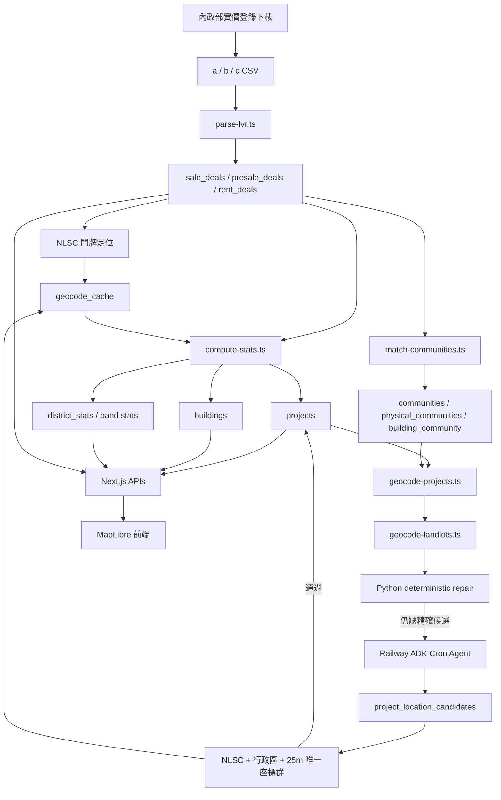

# 房市探探：專案架構與 Agent 交接手冊

> 本文件是給未來 Codex、工程師與維運者的「現況導覽」。  
> 最後核對日期：2026-07-24（Asia/Taipei）。

## 1. 閱讀順序與真實來源

開始修改前，依序閱讀：

1. 本文件：理解整體系統、資料流、部署與已知落差。
2. [`db/schema.ts`](../db/schema.ts)：資料表與型別的唯一 schema 來源。
3. [`etl/run-all.ts`](../etl/run-all.ts) 與 [`package.json`](../package.json)：主 ETL 的實際執行順序與命令。
4. [`project-address-agent/DESIGN_SPEC.md`](../project-address-agent/DESIGN_SPEC.md)：地址 Agent 的安全契約。
5. 對應模組的程式碼與測試：文件可能落後，程式與 production 查詢結果才是最後事實。

重要原則：

- 不要把本文件中的 production 數字當成永久常數；它們只是日期化快照。
- 不要把 README 的描述當成 schema 或執行順序的替代品。
- 任何 Agent 行為變更都必須先對照 `DESIGN_SPEC.md`。
- 不要在未獲使用者明確同意時部署。
- 不要在 log、命令輸出、文件或 Git 中暴露 Railway／Google 金鑰。

## 2. 系統目的

房市探探是北北桃房市資料產品，目前主要呈現：

- 預售建案成交行情。
- 中古／成屋棟級成交行情。
- 屋齡 1–10 年住宅租賃行情。
- 行政區、生活圈、交通節點與建案搜尋。
- 預售建案詳情、棟別／戶別成交、解約與契約建材資料。

主要城市由 [`src/lib/cities.ts`](../src/lib/cities.ts) 統一管理：

| code | DB 城市名 | UI 顯示 |
|---|---|---|
| `h` | 桃園市 | 桃園 |
| `a` | 臺北市 | 台北 |
| `f` | 新北市 | 新北 |

## 3. 技術棧

### Web 應用

- Next.js 14 App Router
- React 18
- TypeScript
- MapLibre GL / react-map-gl
- Drizzle ORM
- PostgreSQL 16
- Tailwind CSS 4 / shadcn 元件

### ETL

- Node.js 22
- TypeScript + `tsx`
- 內政部實價登錄 CSV
- NLSC 國土測繪中心定位 API
- GeoJSON 行政區／生活圈資料
- Playwright + Poppler（契約 PDF）

### 地址修復 Agent

- Python 3.11–3.13
- Google ADK 2.x
- `gemini-3-flash-preview`
- psycopg 3
- httpx
- Railway Cron

模型名稱是既有契約的一部分。除非使用者明確要求，禁止自行更換
`gemini-3-flash-preview`。

## 4. 高階架構



## 5. Repository 目錄責任

| 路徑 | 責任 |
|---|---|
| `src/app/` | Next.js 頁面、layout、API routes |
| `src/components/` | 地圖、抽屜、列表與 UI 元件 |
| `src/lib/` | Web DB client、地圖資料轉換、城市與 API 參數 |
| `db/schema.ts` | 唯一 schema 來源 |
| `db/migrations/` | Drizzle migration SQL |
| `db/client.ts` | ETL DB pool 與 schema export |
| `etl/` | 下載、解析、定位、彙總、品質檢查 |
| `etl/downloads/` | 下載後的 MOI CSV；大型資料，不應納入映像 |
| `data/` | 行政區、生活圈與租金基準靜態資料 |
| `project-address-agent/` | 隔離的 Python ADK 地址修復系統 |
| `.github/workflows/` | CI 與正式 ETL 排程 |
| `tests/` | TypeScript 單元／整合測試 |

## 6. 外部資料來源

### 6.1 內政部實價登錄

`etl/download-lvr.ts` 依 `CITIES` 下載各城市資料：

- `a`：中古／成屋買賣。
- `b`：預售屋買賣。
- `c`：租賃。

資料存進 `etl/downloads/{season}/`，再由 `etl/parse-lvr.ts` 解析。

### 6.2 預售建案備查 buildcase

地址 Agent 使用內政部預售備查壓縮檔：

```text
https://plvr.land.moi.gov.tw/Download
  ?type=zip
  &PayType=saleremark
  &fileName=lvr_buildcasecsv.zip
```

本機優先讀：

```text
etl/downloads/buildcase/{a,f,h}_lvr_buildcase.csv
```

Railway 映像中若沒有檔案，`evidence.py` 會下載到暫存目錄。

### 6.3 NLSC

用途：

- 完整門牌 → `lat/lng`
- 確切兩路口 → `lat/lng`
- 地段＋地號 → `lat/lng`

NLSC 只是「候選地址驗證與定位服務」，它不知道哪個地址屬於哪個建案。
建案與地址的關聯必須來自本機 MOI 證據。

### 6.4 交通圖資（TDX + OSM，手動 ETL）

車站與軌道資料不在每旬 `etl:all` 內；城市清單異動後手動重跑，產出直接 commit 進 `data/`：

| Script | 產出 | 來源 |
|---|---|---|
| `etl/fetch-stations.ts` | `data/stations.geojson`、`data/bus-stops.geojson` | TDX（各市捷運 operator／台鐵、公車站牌）＋ OSM（施工中站、國道交流道）|
| `etl/fetch-rail-lines.ts` | `data/rail-lines.geojson` | OSM Overpass（免憑證；只畫有站點的線，規劃中路線刻意不畫）|

`fetch-stations.ts` 需要 TDX client credentials（`TDX_Client_ID`／`TDX_Client_Secret`，見第 15 節）。

### 6.5 生活圈邊界

- 主要來源：樂居 subarea API 的手繪邊界，存 `data/leju-subareas-{slug}.geojson`。
  `api.leju.com.tw` 有 Cloudflare 驗證，ETL 無法直接重抓，須以瀏覽器手動更新來源檔。
- `etl/leju-zones.ts` 將來源檔以 `leju_id` 去重、合併跨區重複後產出 `data/zones.geojson`。
- 舊版官方 GIS 管線（`etl/build-zones.ts` 桃園都計圖資、`etl/build-ntpc-zones.ts`）保留作替代來源。
- `zone_key = city|name`：跨市撞名時的唯一鍵，`name` 只作顯示。

### 6.6 其他資料

- 使用執照：`use_permits`。雙北走整批開放資料（`etl/import-use-permits.ts`）；
  桃園無整批資料源，由 `etl/match-permit-doors.ts` 按備查案建照號碼逐案查
  桃園建管 BUILDLIC API 補入（import-use-permits 對桃園 no-op，不會清掉這些列）。
- 預售契約 PDF／建材設備：`contract_materials`
- 300 億租金補貼有效租約統計：`rent_benchmarks`
- 樂居資料只作輔助歸戶／生活圈，不是地址 Agent 自動發布證據

## 7. 主 ETL

### 7.1 正式順序

`pnpm etl:all` 實際執行：

1. `etl:download`
2. `etl:parse`
3. `etl:fix-names`
4. `etl:geocode`
5. `etl:stats`
6. `etl:use-permits`
7. `etl:communities`
8. `etl:geocode-projects`
9. `etl:geocode-lots`
10. `etl:match-leju`
11. `etl:presale-doors`
12. `etl:permit-doors`
13. `etl:repair-projects`
14. `etl:zone-bands`
15. `etl:rent-benchmarks`
16. `etl:zone-rents`

`etl:all` 會：

- 在 `etl_runs` 建立 `running` 記錄。
- 逐步執行以上命令。
- 蒐集資料品質 metrics。
- 發現阻斷錯誤時將 run 標為 `failed`。
- 成功時寫入 `success`、完成時間與 metrics。
- 無論成功或失敗都關閉 DB pool。

### 7.2 下載與解析

`parse-lvr.ts` 將資料寫入：

- `sale_deals`
- `presale_deals`
- `rent_deals`

重要行為：

- 以 `(raw_season, city)` 為替換範圍。
- 先解析到記憶體，再在 transaction 內刪除舊範圍並插入新資料。
- `replacement-safety.ts` 阻止 0 筆或相對舊資料驟降超過 30% 的發布。
- 只有明確使用 `--allow-empty` 才能接受空結果。
- 預售解約資料保留，但 `is_cancelled=true`，價格統計排除。

### 7.3 一般門牌定位

`etl:geocode.ts`：

- 將中古／租賃門牌標準化成 `addr_key`。
- 查詢 NLSC。
- 將結果寫入 `geocode_cache`。
- 後續增量執行優先使用快取。

### 7.4 統計與建案

`etl/compute-stats.ts` 重建或更新：

- `district_stats`
- `district_band_stats`
- `projects`
- `buildings`
- `room_stats`

`projects` 的 `lat/lng` 在 upsert 時不被統計值覆蓋；新建案先保留 `null`，
再交給建案定位流程。

### 7.5 社區歸戶

`etl/match-communities.ts` 負責：

- 建立預售備查案 `communities`。
- 合併實體社區 `physical_communities`。
- 建立 `community_cases`。
- 透過地號交集將中古門牌連到 `building_community`。

### 7.6 樂居門牌歸戶（`etl:match-leju`）

`etl/match-leju-buildings.ts` 是地號歸戶之外的獨立資料通路：把
`etl/coord-overrides.json` 中樂居查證的「建案名 ↔ 門牌」灌進既有社區結構，
讓 2021 年前無備查資料的建案也能接上「交屋後轉售」管線。

流程：

1. 錨點＝override 門牌在 `buildings` 的精確 `addr_key` 命中（查無代表尚無成屋交易，跳過）。
2. 群聚＝同街道前綴＋完工年 ±1＋距錨點 ≤70m 的其他棟。
3. `communities` upsert 合成列（`case_no='leju|城市|區|建案名'`）。
4. `building_community` upsert（`match_method='leju-door'`，錨點 confidence=100、鄰棟 80）。

不覆蓋既有的地號歸戶結果；冪等可重跑。

### 7.7 老案門牌歸戶（`etl:presale-doors`）

實登 2.0（2021-07）前的預售案交屋前後才申報，b 檔地址即真門牌
（「吉安街171號11樓B3-11F」）。`etl/match-presale-doors.ts` 對無歸戶案：

1. 從 `presale_deals.address` 抽「街路＋號」（剝市/區/里鄰前綴；「號旁」等描述型拒絕）。
2. 門檻：門牌列 ≥6、相異門牌 ≥2、主要街道 ≥80%、門牌列佔全案 ≥50%。
3. 合成 `communities`（`case_no='pd|城市|區|建案名'`，`first_reg` 用門牌上
   `sale_deals.build_year` 多數決）＋ `building_community`（`match_method='presale-door'`）。
4. 跨案搶同一門牌整個放棄；不覆蓋地號/樂居歸戶。
5. 順帶把地址尾碼的棟戶代號（A1-4F）回填 `unit_id`，老案棟別圖因此可畫。

另 `project-detail` 對老案直接從地址派生「棟戶↔門牌」錨點（`unit_doors`），
與 2.0 後案的 a/b 檔重複揭露 join 併用，轉售按門牌歸回棟別圖欄位。

### 7.8 使照門牌歸戶（`etl:permit-doors`）

近半數備查列「編號」空白只剩單一代表地號，大基地案地號交集恆零。
`etl/match-permit-doors.ts` 以備查案建照號碼查桃園建管 BUILDLIC API：

1. `communities.permit_no` → `parsePermit` 拆年度/區碼/序號（備查登打髒，
   「字第」可能漏寫、年度可能缺），以「原領執照字號」模糊查使用執照。
2. 比對走 `permitsMatch`：序號必等；年度與區碼兩邊都有才比；缺項（lenient）
   需使照門牌/地號行政區落在本案行政區才收。
3. 使照「逐戶門牌清單」→ `normAddrKey`（連字號轉「之」）→ `building_community`
   （`match_method='permit-door'`，confidence 98，不覆蓋既有歸戶）。
4. 使照本體 upsert 進 `use_permits`（桃園逐案補），並回填 `communities.use_issue_date`。

查詢結果快取在 `etl/downloads/permit-doors/`（GHA 以 actions/cache 保留），
查無使照 30 天後重試（新完工案領照後自動補上）。冪等；每晚 `building_community`
重建後由本步驟重灌。

## 8. 建案地址與座標流程

### 8.1 第一層：TypeScript 地址解析

`etl/geocode-project-address.ts` 接受三種型態：

| 型態 | 範例 | 是否可定位 |
|---|---|---|
| `door` | 中正路100號附近 | 是；去掉「附近」後查精確門牌 |
| `cross` | 中正路與民生路交叉口附近 | 是；查確切兩路口 |
| `road` | 中正路附近 | 否；只有道路，不可當精確點 |

尾綴如「附近、旁、對面、上」會先移除，但移除後仍必須是完整門牌或兩路口。

`etl/geocode-projects.ts` 的資料優先順序：

1. 同建案 `presale_deals` 中最常見地址。
2. 同市、區、建案名的 `communities.street`。
3. 既有精確 `geocode_cache`。

只有道路或巷名時，會寫 `precision=none`，不向使用者偽裝成精確座標。

### 8.2 第二層：地號

`etl/geocode-landlots.ts` 使用地段與地號定位第一層無法處理的建案。

### 8.3 第三層：Python deterministic repair

`pnpm etl:repair-projects` 執行：

```bash
uv run --project project-address-agent \
  --no-dev --locked \
  project-address-agent auto --apply --limit 100
```

它會：

1. audit `presale_deals` 與 `projects`。
2. 同步 `project_location_cases`。
3. 從交易、community、buildcase 抽出精確候選。
4. 用 NLSC 驗證。
5. 用行政區 polygon 驗證。
6. 將所有有效候選分成 25 公尺座標群。
7. 只有一個群時自動發布。
8. 將已處理案件移到 queue 尾端，避免後方案件餓死。

## 9. 地址修復 Agent

### 9.1 為什麼需要 Agent

確定性 regex 擅長抽出格式清楚的門牌、路口與地號，但會遇到：

- 證據欄位多、需要判斷哪一個最可信。
- 建案名稱、棟別、工地描述混在同一段文字。
- 多個官方資料欄位需要語意比較。

Agent 只負責理解與選擇「文字候選」，不負責產生座標。

### 9.2 Python 模組責任

| 檔案 | 責任 |
|---|---|
| `agent.py` | 互動式 `root_agent` 與受限 `cron_agent` |
| `autonomous.py` | Railway 無人值守 cycle、ADK Runner、timeout、Token 統計 |
| `config.py` | 環境變數與模型設定 |
| `models.py` | dataclass／型別定義 |
| `automatic.py` | 確定性候選驗證、25m cluster、自動發布 |
| `audit.py` | audit summary 與 case 同步 |
| `db.py` | case/candidate persistence、review、publish、reapply |
| `evidence.py` | 收集交易、community、buildcase、contract 證據 |
| `resolver.py` | 候選 regex、來源優先級、Agent proposal 反向證據核對 |
| `nlsc.py` | NLSC 門牌／路口／地號驗證 |
| `geo.py` | Polygon／MultiPolygon 行政區 containment |
| `tools.py` | ADK 暴露工具 |
| `cli.py` | `audit`、`auto`、`cycle`、人工覆核命令 |

### 9.3 兩個 Agent

#### `root_agent`

供人工互動調查：

- audit
- inspection
- validation
- staging
- list candidates
- Google Search fallback

搜尋只可提供線索。只靠網頁搜尋的候選不能自動發布。

#### `cron_agent`

供 Railway 無人值守排程：

- `inspect_project_evidence`
- `validate_location_candidate`
- `stage_location_candidate`

它沒有：

- Google Search
- 全庫 audit 工具
- review／approve
- publish
- 直接寫座標能力

### 9.4 Railway cycle

`cycle --apply` 流程：

1. 查詢 8 小時內是否有 `etl_runs.status=running`。
2. 若主 ETL 正在執行，本輪安全跳過。
3. 先執行 deterministic repair。
4. 只將 `no_precise_candidate`、`no_validated_candidate` 交給 Agent。
5. 每案建立獨立 ADK in-memory session。
6. 每案 timeout 120 秒。
7. 記錄 prompt、candidate、thought、cached 與 total tokens。
8. Agent 完成後，程式重新讀本機證據。
9. 重新跑 deterministic gate。
10. 關閉 Runner、HTTP client 與 DB connection，process 結束。

目前預設上限：

```text
deterministic limit = 100 cases / run
Agent limit         = 3 cases / run
LLM call limit      = 3 calls / case
hard code ceiling   = 20 cases, 12 calls / case
```

Production smoke test 曾處理 1 案、3 次模型呼叫、共 11,620 tokens。
該案只有「巷」而無門牌，Agent 正確拒絕 staging。

## 10. 自動發布安全契約

### 10.1 允許的候選

- `door`：完整門牌，必須到「號」。
- `cross`：兩條道路的確切交叉口。
- `lot`：地段／小段＋地號。

### 10.2 拒絕的候選

- 只有道路，例如「中正路附近」。
- 只有巷，例如「中正東路二段5巷」。
- 社區、地標、商圈或行政區中心。
- Agent 自己提供的 `lat/lng`。
- 只在網頁搜尋中出現、無本機官方證據的地址。

### 10.3 自動發布必須全部成立

1. 候選是允許型態。
2. 候選逐字存在於本機 MOI transaction／community／buildcase 證據。
3. NLSC 精確驗證成功。
4. NLSC 結果位於預期城市、行政區 polygon。
5. 同案所有可驗證候選只形成一個 25 公尺座標群。
6. 寫入者是 deterministic runner，不是 LLM tool。

若任一條件不成立：

- 不修改 `projects.lat/lng`。
- 案件留在 queue。
- 下一輪繼續處理。

### 10.4 發布內容

成功後：

- 更新 `projects.lat/lng`。
- 更新 `geocode_cache`。
- candidate 標為 `published`。
- case 標為 `published`。
- `reviewed_by=auto:official-evidence`。
- 保存 evidence、NLSC payload、rationale 與 timestamps。

之後主 ETL 如重建資料，`apply_published_automatic()` 會重新套用已發布決策。

## 11. Agent 狀態模型

### 11.1 Audit failure reason

| reason | 意義 | 自動 Agent |
|---|---|---|
| `missing_name` | 原始資料沒有建案名 | 不處理 |
| `below_threshold` | 有效成交少於 3 筆 | 不處理 |
| `project_missing` | 達門檻但沒有 `projects` row | 報告，上游問題 |
| `name_mangled` | 名稱有 `?`／`�` 且缺座標 | 保守處理 |
| `project_no_coord` | project 存在但缺座標 | 主要目標 |
| `resolved` | 已有座標 | 不處理 |

### 11.2 Case status

```text
open → researching → staged → published
                       └────→ closed / 繼續等待
```

### 11.3 單次處理結果

| result | 意義 |
|---|---|
| `no_precise_candidate` | 沒抽到門牌／路口／地號 |
| `no_validated_candidate` | 有候選，但 NLSC／行政區未通過 |
| `too_many_candidates` | 超過單案 20 候選安全上限 |
| `ambiguous_coordinates` | 有效候選形成多個座標群 |
| `missing_district` | 無法可信推斷行政區 |
| `published` | 已通過完整自動 gate |
| `error` | 外部服務或程式錯誤；queue 繼續 |

## 12. PostgreSQL 資料模型

### 12.1 原始層

| 表 | 用途 |
|---|---|
| `presale_deals` | 預售逐筆成交與解約 |
| `sale_deals` | 中古／成屋逐筆成交 |
| `rent_deals` | 租賃逐筆資料 |

### 12.2 定位與實體層

| 表 | 用途 |
|---|---|
| `geocode_cache` | 標準化地址或 project candidate 的 NLSC 結果 |
| `projects` | 預售建案彙總與正式座標 |
| `buildings` | 中古棟級彙總與座標 |
| `communities` | MOI 預售備查案 |
| `physical_communities` | 合併後的實體社區 |
| `community_cases` | 實體社區與備查案關聯 |
| `building_community` | 門牌棟與備查案／社區關聯 |

### 12.3 彙總層

| 表 | 用途 |
|---|---|
| `district_stats` | 行政區行情 |
| `district_band_stats` | 行政區 × 屋齡帶 |
| `zone_stats` | 生活圈租金 |
| `zone_band_stats` | 生活圈 × 屋齡帶 |
| `room_stats` | 房數帶價格／總價／筆數 |
| `rent_benchmarks` | 官方租金基準 |

### 12.4 補充資料

| 表 | 用途 |
|---|---|
| `use_permits` | 使用執照與完工日 |
| `contract_materials` | 契約建材設備與 PDF |
| `etl_runs` | ETL 狀態、metrics、錯誤 |

### 12.5 Agent staging

#### `project_location_cases`

唯一鍵：

```text
(city, district, project_name)
```

保存 failure reason、deal counts、原始地址、狀態與時間。

#### `project_location_candidates`

唯一鍵：

```text
(case_id, candidate_kind, candidate_value)
```

保存來源、證據、驗證結果、座標、審核與發布記錄。

## 13. API 與前端

### 13.1 主要 API

| Route | 用途 |
|---|---|
| `GET /api/points` | 有座標的預售／中古 GeoJSON 點位 |
| `GET /api/project-index` | 全量建案搜尋索引，包含無座標建案 |
| `GET /api/project-detail` | 建案、成交、社區、轉售與建材詳情 |
| `GET /api/districts` | 行政區 GeoJSON 與預算統計 |
| `GET /api/zones` | 生活圈／重劃區 |
| `GET /api/rentals` | 1–10 年住宅租賃點位 |
| `GET /api/stations` | 軌道車站與國道交流道（靜態 `data/stations.geojson`）|
| `GET /api/rail-lines` | 軌道路線幾何（靜態 `data/rail-lines.geojson`）|
| `GET /api/health/data` | 最近成功 ETL 與 stale 狀態 |

`stations`／`rail-lines` 不讀 DB：直接回傳 `data/` 靜態檔並設 `revalidate = 86400`。
檔案本身就是城市閘門——啟用新城市後重跑 `fetch-stations.ts`／`fetch-rail-lines.ts`
重新產生，API 端刻意不做 bbox／城市過濾（避免截斷機捷北段等跨市路線）。

### 13.2 地圖可見性

`/api/points` 只查詢 `lat IS NOT NULL` 的 `projects`／`buildings`。

因此：

- `projects` 有 row 但缺座標：不出現在地圖。
- 同一建案仍會出現在 `/api/project-index`。
- 搜尋無座標建案時，前端直接開詳情抽屜，不飛到地圖。
- 地址 Agent 成功寫入 `projects.lat/lng` 後，下一次 API 查詢即可顯示。

`toFeatureCollection()` 可能為完全重疊的多個點產生小幅環狀顯示偏移；
這只改 API 輸出的 render coordinate，不修改 DB 真實座標。

### 13.3 前端入口

- `src/app/page.tsx`：頁面入口。
- `src/components/PropertyMap.tsx`：資料載入、地圖狀態、搜尋、篩選。
- `src/components/ProjectDrawer.tsx`：建案詳情與逐筆成交。
- `src/components/MobileExplorer.tsx`：手機列表／搜尋體驗。

## 14. 排程與部署

### 14.0 Vercel Web 部署

Next.js 應用部署在 Vercel：

| 項目 | 值 |
|---|---|
| Project | `roi`（`.vercel/project.json`）|
| Production URL | `https://roi-nu.vercel.app` |
| 部署方式 | push `main` 自動部署（Git 整合）|
| 資料庫 | 連 Railway Postgres，`DATABASE_URL` 設在 Vercel 環境變數 |

行為要點：

- API routes 皆為 `force-dynamic`，但回應帶 cache headers，由 Vercel CDN 吸收流量。
- `data/` 靜態 geojson 隨 repo 一起部署；更新圖資＝commit 檔案＋push。
- ETL 不在 Vercel 上跑；Vercel 只讀 DB 彙總層與靜態檔。

### 14.1 GitHub Actions ETL

Workflow：`.github/workflows/etl.yml`

排程：

```text
0 20 1,11,21 * *
```

Railway／GitHub Cron 都用 UTC，因此是台灣時間每月 2、12、22 日 04:00。

流程：

- migration
- `pnpm etl:all`
- 契約 PDF 增量抓取（需 poppler 與 playwright chromium）

同一時間只允許一個 `etl` concurrency group，不取消進行中的工作。

`workflow_dispatch` 手動觸發時有兩個 input：

| input | 用途 |
|---|---|
| `seasons` | 歷史季別回填（空白分隔，如 `110S3 110S4`；留空＝只跑最新一期）|
| `contracts_limit` | 契約建材抓取單次上限（預設 80）|

歷史回填首輪會對 NLSC geocode 大量新門牌，可能跑數小時；進度存
`geocode_cache`，超時重跑即續傳（workflow timeout 340 分鐘）。

### 14.2 Railway 地址 Agent

Production 資源：

| 資源 | 名稱 | ID |
|---|---|---|
| Project | `roi` | `4190e128-839b-4fbc-8c26-5827e105d2f9` |
| Environment | `production` | `940cf3d5-c6b6-46d4-a74d-a0bcdde79320` |
| Postgres | `Postgres` | `5704cd3d-edb9-459d-83d4-5608ebd1f7c0` |
| Cron service | `address-agent-cron` | `b899722e-92ee-4344-8b54-08b70e637816` |

設定：

```text
region             = us-west2
cron               = 0 22 * * *
台灣時間           = 每天 06:00
restartPolicyType  = NEVER
public domain      = none
Dockerfile         = project-address-agent/Dockerfile
```

平常 `running=0` 是正常狀態。Railway 到時間才啟動 container，完成後退出。

必要變數：

```text
DATABASE_URL=${{Postgres.DATABASE_URL}}
GOOGLE_API_KEY=<Railway secret>
GOOGLE_GENAI_USE_VERTEXAI=FALSE
ADDRESS_AGENT_MODEL=gemini-3-flash-preview
ROI_REPO_ROOT=/app
ADDRESS_AGENT_ALLOW_PUBLISH=0
```

注意：

- `ADDRESS_AGENT_ALLOW_PUBLISH=0` 只關閉人工 publish 命令。
- 無人值守 automatic gate 使用獨立的程式安全條件。
- 目前 Railway service 是 local source deployment，不是 GitHub autodeploy。
- 本機程式變更不會自動更新 Railway；必須重新 `railway up`。
- repository 根目錄不要永久放 Agent 專用 `railway.json`，否則未來其他
  Railway service 可能誤用 Agent Dockerfile。
- 現有部署的 service manifest 已保存 Dockerfile 與 Cron 設定。若從新 source
  部署，應在部署前明確提供同等 config，部署後再確認 `buildOnly=true` 與
  `cronSchedule=0 22 * * *`。

## 15. 環境變數

### Web／ETL

| 變數 | 用途 |
|---|---|
| `DATABASE_URL` | PostgreSQL |
| `PG_POOL_MAX` | production DB pool 上限 |
| `PG_CONNECT_TIMEOUT_MS` | 連線 timeout |
| `PG_IDLE_TIMEOUT_MS` | idle timeout |
| `ETL_WORKFLOW` | `etl_runs.workflow` |
| `GITHUB_SHA` | ETL git revision |
| `TDX_Client_ID` | TDX 憑證（僅 `fetch-stations.ts` 手動 ETL 用）|
| `TDX_Client_Secret` | TDX 憑證（同上）|

### Agent

| 變數 | 用途 |
|---|---|
| `DATABASE_URL` | 同一個 PostgreSQL |
| `GOOGLE_API_KEY`／`GEMINI_API_KEY` | Google AI Studio |
| `GOOGLE_GENAI_USE_VERTEXAI` | 是否使用 Vertex AI |
| `GOOGLE_CLOUD_PROJECT` | Vertex AI project |
| `ADDRESS_AGENT_MODEL` | 保持 `gemini-3-flash-preview` |
| `ROI_REPO_ROOT` | district GeoJSON 與 ETL 資料根目錄 |
| `ADDRESS_AGENT_ALLOW_PUBLISH` | 人工 publish 開關 |

禁止：

- 將真實 secret 寫進 `.env.example`、README、Docker image 或 Git。
- 使用 `railway variable list --json` 後直接貼出輸出；它包含 raw values。
- 在命令列參數中直接放 secret。設定 secret 時使用不回顯 stdin。

## 16. 本機操作

### 16.1 Web 與 DB

```bash
pnpm install
docker compose up -d
pnpm db:migrate
pnpm db:seed
pnpm dev
```

### 16.2 完整 ETL

```bash
pnpm etl:all
```

只檢查資料品質：

```bash
pnpm etl:quality
```

### 16.3 Agent

```bash
cd project-address-agent
uv sync
uv run project-address-agent audit --limit 20
uv run project-address-agent auto --limit 50
uv run project-address-agent cycle --limit 100
```

會修改資料：

```bash
uv run project-address-agent auto --apply --limit 50
uv run project-address-agent cycle \
  --apply \
  --limit 100 \
  --agent-limit 3 \
  --max-llm-calls 3
```

互動式 ADK：

```bash
uv run adk run project_address_agent
uv run adk web .
```

## 17. 測試與完成條件

### TypeScript

```bash
pnpm typecheck
pnpm test
pnpm build
```

### Python

```bash
cd project-address-agent
uv run ruff check .
uv run pytest -q
```

### ADK eval

```bash
cd project-address-agent
uv run adk eval project_address_agent evals/address_repair.evalset.json
```

注意：`pytest` 不等於 Agent eval。修改 Agent prompt、工具或模型行為時，
必須使用有效但未暴露的 Google credential 執行 ADK eval。

CI 會執行 migration、TypeScript typecheck/tests、Python tests 與 Next build。

## 18. Production 快照

查詢時間：2026-07-24。

### Audit

| reason | 數量 |
|---|---:|
| `resolved` | 2,569 |
| `project_no_coord` | 720 |
| `name_mangled` | 17 |
| `below_threshold` | 665 |
| `missing_name` | 31 |
| `project_missing` | 0 |
| 總 groups | 4,002 |

依 Agent 三筆門檻計算：

- 符合資格且有名稱：3,306。
- 已定位：2,569（77.7%）。
- 尚缺座標：737（22.3%）。

### Agent queue

| 狀態／原因 | 數量 |
|---|---:|
| open | 504 |
| researching | 1 |
| published cases | 6 |
| open `project_no_coord` | 475 |
| researching `project_no_coord` | 1 |
| open `name_mangled` | 14 |
| open stale `project_missing` | 15 |
| published candidates | 6 |

Audit 的 737 個地址目標與目前可自動處理 queue 490 個之間有 247 個差額。
每次 deterministic cycle 都會先重新 audit 並 upsert queue；調查數量差異時，
同時查 `project_location_cases.last_audited_at` 與最近 `etl_runs`，不要只看其中一表。

## 19. 已知限制與設計／實作落差

### 19.1 三筆門檻目前不一致

Agent spec 與 `classify_project()`：

```text
active_deals < 3 → below_threshold
```

但 `etl/compute-stats.ts` 目前建立／保留 `projects` 的 SQL 是：

```sql
HAVING count(*) >= 1
```

這代表：

- UI／`projects` 可能包含只有 1–2 筆有效成交的建案。
- Agent audit 仍把這些建案視為 `below_threshold`，不做地址修復。
- README 中「三筆才建立 projects」不是目前 `compute-stats.ts` 的實際行為。

這是需要產品決策的 drift，不能在其他任務中順手修改。

若要統一：

1. 先決定前端是否真的要三筆門檻。
2. 同步修改 `compute-stats.ts`、audit spec、測試、文件與 quality baseline。
3. 評估會從 `projects`／地圖移除多少現有建案。
4. 使用 replacement guard 與 production dry-run。

### 19.2 Road-only 永遠不應自動定位

「中正路附近」只會得到 road-level 資訊，不可取道路中心點。
必須從其他 MOI evidence 找到完整門牌、路口或地號。

### 19.3 Agent 不是上游資料補抓器

Agent 只能處理已存在於 `presale_deals` 的建案。

它無法修復：

- MOI 檔案根本沒下載。
- CSV 解析範圍漏掉。
- 原始交易未入庫。
- 建案名稱完全缺失。

這些問題應從 `etl_runs`、下載檔、`raw_season` 與 parse replacement metrics 調查。

### 19.4 Token 與處理速度

目前最多 3 個 Agent cases／日。若所有 737 案都需要 LLM，理論上完整輪詢會很慢；
實際上 deterministic pass 每天先掃 100 案，許多案件不需 LLM。

調高 `agent-limit` 前先看 Railway logs 中的：

- `processed`
- `model_calls`
- `usage.total_token_count`
- 發布成功率

### 19.5 Credential

曾有 Google API key 出現在對話中。實際值不得複製到本文件或 Git。
功能雖可運作，安全上應輪替後再更新 Railway secret。

### 19.6 ADK eval

目前有安全 evalset，但 production 部署前的真實模型 eval 曾受缺少安全新金鑰限制。
未來修改 Agent 行為時，不能只以 fake Runner unit test 取代真實 ADK eval。

## 20. 常見故障定位

### 建案在搜尋中但地圖沒有

1. 查 `/api/project-index` 的 `geo`。
2. 查 `projects.lat/lng`。
3. 查 `project_location_cases`。
4. 查 `geocode_cache` 是否是 `none`。
5. 收集 transaction／community／buildcase evidence。

### 建案完全搜尋不到

1. 查 `presale_deals` 是否存在。
2. 查 `raw_season` 與 city。
3. 查 project name 是否 `null`／亂碼／不同別名。
4. 查 `compute-stats` 是否執行。
5. 查有效／解約成交筆數。

### Cron 沒有執行

1. 確認最新部署 `status=SUCCESS`。
2. 確認 `buildOnly=true`。
3. 確認 `cronSchedule=0 22 * * *`。
4. `running=0` 平常是正常。
5. 若前一輪仍 Active，Railway 會跳過下一輪。
6. 查 worker 是否關閉 ADK、HTTP 與 DB resources。
7. 查是否因 8 小時內主 ETL `running` 而安全跳過。

### Agent 有答案但沒有發布

依序查：

1. 候選是否逐字存在於本機官方 evidence。
2. 是否是 door／cross／lot。
3. NLSC 是否精確命中。
4. 是否在正確行政區。
5. 是否有多個相距超過 25m 的有效候選。
6. verification second pass 是否執行。

### ETL 後資料大幅減少

不要直接允許清空。先查：

- 下載檔是否完整。
- CSV header／編碼是否變更。
- city/season replacement scope。
- `replacement-safety.ts` 的 previous/next counts。
- 最近成功 `etl_runs.metrics`。

## 21. 未來修改 Checklist

### 一般修改

- [ ] 先看 `git status`，保留使用者未提交變更。
- [ ] 確認真正 source of truth。
- [ ] 修改範圍保持最小。
- [ ] schema 變更要產生 migration。
- [ ] 跑 typecheck、tests 與 build。

### Agent 修改

- [ ] 先讀 `DESIGN_SPEC.md`。
- [ ] 保留 `gemini-3-flash-preview`，除非使用者要求。
- [ ] 不給 Agent publish／coordinate-write 工具。
- [ ] 不讓 web-only evidence 自動發布。
- [ ] 保留 NLSC、行政區與單一 cluster gate。
- [ ] 跑 ruff、pytest 與真實 ADK eval。
- [ ] 取得明確核准後才部署。

### Railway 部署後

- [ ] 確認目標 project/environment/service ID。
- [ ] 確認沒有動到 Postgres service。
- [ ] 只列 variable keys，不輸出 raw values。
- [ ] 確認 Docker build success。
- [ ] 確認 `cronSchedule`、`buildOnly`、`restartPolicyType`。
- [ ] 用受限 smoke run 驗證 DB 與模型。
- [ ] 恢復正式 Cron。
- [ ] 刪除本機一次性 root `railway.json`。
- [ ] 查看 Token 與是否有錯誤發布。

## 22. 不可破壞的核心不變量

1. 原始 MOI 交易與衍生彙總必須分層。
2. 取消交易保留，但不得進入有效價格統計。
3. 只有精確門牌、路口或地號可以成為正式建案座標。
4. LLM 永遠不能直接提供或發布 `lat/lng`。
5. 網頁搜尋不能單獨成為自動發布依據。
6. `projects.lat/lng` 是前端地圖可見性的直接條件。
7. 無座標建案仍應可經 `/api/project-index` 搜尋與開啟詳情。
8. ETL 替換必須有 transaction 與數量防護。
9. Cron worker 必須完成後退出。
10. Secret 不得進入 Git、log、Docker image 或文件。

